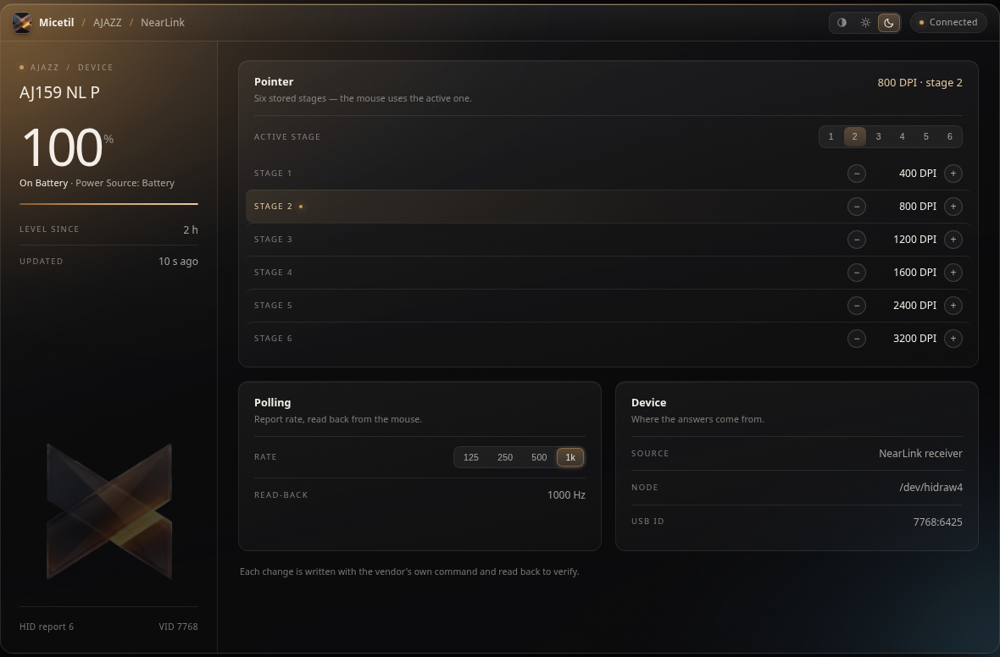

<p align="center">
  
</p>

<p align="center">
  <em>A local control panel for the AJAZZ AJ159 NL P mouse — written on Linux,
  against the vendor's own HID protocol, with every write verified by the
  device itself.</em>
</p>

---

## What it is

Micetil shows the mouse's **real battery level** and controls the mouse's
**DPI stages**, the **active DPI stage** and the **report rate** — from a
browser on the same machine, with no driver, no Wine, no root and no
network access.

| | |
|---|---|
| **Battery** | the percentage the mouse reports, charging state, and which node answered |
| **DPI stages** | read the six stored stages, change any of them in 50 DPI steps |
| **Active stage** | choose which of the six stages the mouse is using right now |
| **Report rate** | 125 / 250 / 500 / 1000 Hz, read back from the mouse |

It prefers the mouse's own wired USB interface (it knows about charging)
and falls back to the NearLink receiver, re-scanning every five seconds —
so plugging the mouse in or unplugging it needs no restart.

```
http://127.0.0.1:8778
```



---

## Quick start

```bash
git clone https://github.com/alfaisaldev/micetil.git
cd micetil
./install.sh          # udev rule + systemd user service + app-menu launcher
```

`install.sh` is the only thing that needs `sudo`, and only for the udev
rule that lets your user read the mouse's hidraw node:

```
SUBSYSTEM=="hidraw", ATTRS{idVendor}=="7768", MODE="0660", GROUP="plugdev", TAG+="uaccess"
```

Without installing anything, run it by hand:

```bash
python3 server.py --port 8778
```

Standard library only — no packages to install, no build step.

---

## How this was made — the short story

The mouse is an AJAZZ AJ159 NL P, USB vendor id `0x7768`. It ships with a
Windows driver that does all of this, and nothing on Linux. So the first
job was to find out what the driver actually says to the mouse.

**1. Two devices, one protocol.** The NearLink receiver (`7768:6425`) and
the mouse itself over USB (`7768:6d25`) both expose a *vendor* HID
collection next to the normal mouse interface. Reading the HID report
descriptor showed it: usage pages `0xFFB1` / `0xFFB2` / `0xFFB3`, with
report id **6** carrying 63-byte frames. The mouse pushes a status packet
on its own — one tag/value entry behind a five-byte header:

```
06 fa 03 00 00 03 64 01
                  |  |  +-- charging flag (1 = the mouse is on USB power)
                  |  +----- percentage = 0x64 = 100 %
                  +-------- tag 0x03 = battery level
```

The first version of the panel was exactly this: a read-only battery
display. That part is easy.

**2. The capture that unlocked the rest.** Reads are easy; *writes* need
the exact frame the vendor driver sends, and guessing is expensive. So a
capture of the Windows application was taken (USBPcap + Wireshark, 179
seconds, 71 k packets) and decoded. Every host → device frame turned out
to be a class control transfer, `SET_REPORT`, `wValue=0x0206` — output
report id 6, 64 bytes long. The same transport `hidraw` offers as
`HIDIOCSOUTPUT`, which is why no root and no `usbfs` are needed:

```
06 | class | len | 00 00 | type | data[len]
```

The capture contained the vendor's own DPI write, once per stage:

```
06 13 05 00 00 01 06 00 90 01 00    stage 0 = 0x0190 =  400 dpi
06 13 05 00 00 01 06 05 80 0c 00    stage 5 = 0x0c80 = 3200 dpi
```

**3. The trap that cost a day.** The read block and the write frame use
*different encodings* for the same number: the block stores `dpi/50 − 1`
(400 → 7), the write frame stores the raw DPI (400 → `90 01`). Writing the
read form made the device clamp to its 50 DPI minimum — all six stages read
back as 50. The table now stores the raw form and the panel shows what the
mouse read back, never what it hoped it had written.

**4. Report rate, measured, not assumed.** The capture showed a settings
write with a one-byte value; the mouse's *own input stream* said what the
values do — median gaps between reports of 8.00 / 4.00 / 2.00 / 1.00 ms,
i.e. 125 / 250 / 500 / 1000 Hz, with the windows before and after the
change identical. Later, the read-back was found too: byte 24 of the
device's info block is the rate index.

**5. The active stage — there is no command for it.** The vendor
application never sends a "select stage" frame. The reason only appeared
after writing the table with the *same* values in a different order: **the
device activates whichever stage frame it received last.** With the table
held constant, writing stage 3 last moved the active stage from 1 to 3,
writing stage 1 last moved it back, and nothing else in the block changed.
So "use stage 4" is the ordinary verified DPI write with the table
re-ordered — no new command, no new risk.

That also exposed a real bug in the panel: editing any DPI stage wrote the
stages 0…5 in order, so **every DPI edit silently moved the mouse to stage
6 (3200 DPI)**. The current stage is now always re-sent last.

**6. The lesson that shaped the project.** Early on, a sweep sent a frame
with an *empty payload* to class `0x12` — and cleared the mouse's **button
map**, twice. Only the vendor's own "Restore Factory Settings" brought it
back, because the frames that write it were never captured. From that day
on, two classes are refused outright (`0x12` records, `0x31` LED/profile),
every write is read back, and a failed write is rolled back.

That is also why the **button map is not editable from Micetil yet**. The
frames were never observed, and a guess would cost the user their
buttons. It stays untouched until it is understood well enough to be
written correctly.

**7. The panel.** A desktop-style window — a device column with the
battery, cards for the pointer stages, the polling rate and the device
itself — in a ProArt-flavoured glass look, with a system / light / dark
theme switch. No framework, one HTML file, a few kilobytes of CSS.

**Still open:** the button map (needs one labelled capture of the vendor
app remapping a side button), and the settings that live in the record and
profile classes.

---

## How it talks to the mouse

### Reading

A read is `06 <class>`; the mouse answers with the same shape:

```
host -> mouse   06 05 01 00 00 00
mouse -> host   06 05 24 00 00 01 | 00 25 6d 12 10 01 01 64 …
```

The class-`0x05` block is 35 bytes and holds most of what the panel shows:

| byte | meaning |
|------|---------|
| 7 | battery percent |
| 10 | number of DPI stages (6) |
| 11 | **active** DPI stage, zero based |
| 12…23 | six u16 LE DPI stages, stored as `dpi / 50 − 1` |
| 24 | report-rate index (0…3 → 125/250/500/1000 Hz) |

### Writing

Two shapes, both taken from the vendor application's own traffic:

```
DPI, one frame per stage
host -> mouse   06 13 05 00 00 01 | 06 <stage> <dpi lo> <dpi hi> 00

report rate
host -> mouse   06 13 02 00 00 02 | <value> 00
```

### Safety model

* Only the five read frames the vendor driver itself sends are allowed
  without an explicit write grant (`ajazz_protocol.READ_ONLY`).
* Classes `0x12` and `0x31` are **quarantined** — a short write to either
  clears stored state, and the button map was lost that way twice.
* Every write is **verified**: the value is read back, and if it does not
  match, the previous table is written again. The panel reports success
  only when the mouse confirms it.
* The receiver relays writes slowly, so a read straight after a write can
  return the previous block — verification polls for up to ~3 s.

---

## The interface

A desktop window, not a phone card: a device column with the battery on
the left, cards for the pointer stages, the polling rate and the device on
the right. The theme control in the title bar switches between **system /
light / dark** and is remembered across restarts. To force a theme from the
URL:

```
http://127.0.0.1:8778/?theme=dark
http://127.0.0.1:8778/?theme=light
```

---

## API

| endpoint | returns |
|----------|---------|
| `GET /api/battery` | `{"percent":100,"ok":true,"detail":"battery reported","node":"/dev/hidraw4","device":"7768:6425","source":"NearLink receiver","charging":false,"chargeState":0,"raw":"06 fa 03 00 00 03 64 00 …","updatedAt":1792610122347,"age":5,"since":1792604206987,"rateHz":1000,"dpi":null,"dpiStage":null,"link":null,"mode":null}` |
| `GET /api/dpi` | `{"ok":true,"dpi":[400,800,1200,1600,2400,3200],"stages":6,"active":1,"activeDpi":800}` |
| `GET /api/stage` | same as `/api/dpi` |
| `POST /api/stage` | body `{"stage":0…5}` → switches the active stage, verified |
| `POST /api/dpi` | body `{"stage":0…5,"dpi":50…26000}` → writes one stage, verified |
| `GET /api/rate` | `{"ok":true,"hz":1000,"options":[125,250,500,1000],"readable":true,"note":"read back from the info block, byte 24"}` |
| `POST /api/rate` | body `{"hz":125|250|500|1000}` → sets the report rate, verified |
| `GET /api/health` | `{"ok":true,"uptime":1234}` |

A failed write answers `{"ok":false,"error":"…"}` together with the values
the device actually holds, so the UI can show the real state instead of an
optimistic guess.

---

## File map

```
micetil/
├── server.py                 the panel's HTTP server: routes, the JSON API,
│                             the verify-and-roll-back write handlers
├── battery.py                device access: finds the vendor hidraw node
│                             (mouse first, receiver second), listens for the
│                             status pushes, parses the TLV entries, reads and
│                             writes the DPI table / stage / report rate
├── ajazz_protocol.py         the wire format: frame encode/decode, the
│                             read-only whitelist, the quarantined classes,
│                             the DPI and rate frame builders
├── install.sh                one-time setup: udev rule, systemd user service,
│                             app-menu launcher
├── static/
│   ├── index.html            the entire UI — one file, no framework, no build
│   └── fonts/                Inter Variable (the closest open SF Pro
│                             substitute, so the type looks right on Linux)
├── assets/                   the brand assets, cropped from the identity board
│   ├── MICETIL_brand_identity.jpg   the source board
│   ├── emblem.png                    the prismatic mark (background keyed out)
│   ├── logo-horizontal.png           the mark + the MICETIL wordmark
│   └── mark-mono.png                 the flat copper monogram (also the icon)
├── docs/
│   ├── CUSTOMIZATION.md      the protocol log: every frame, every
│   │                         measurement, every correction, every dead end
│   ├── panel.png             screenshot of the panel
│   ├── vendor-config.xml     the vendor driver's own config table
│   └── vendor-device-mouse.xml  the mouse's descriptor, as the driver sees it
├── tools/                    the reverse-engineering tools, and the checks
│   ├── selftest.py           the CI test: wire format, encodings, guard
│   │                         rails, HTML/script agreement (no hardware)
│   ├── crop_brand.py         re-cut the brand assets from the board
│   ├── read_blocks.py        read every config block, read-only
│   ├── dpi_roundtrip.py      write the DPI table with the vendor frame and
│   │                         verify it
│   ├── measure_rate.py       measure the mouse's real USB polling rate
│   ├── monitor_input.py      watch the raw interrupt-IN traffic
│   ├── track_status.py       log decoded status frames over time
│   ├── parse_capture.py      decode the host → mouse frames of a USB capture
│   ├── usbpcap_extract.py    fast USBPcap/pcapng extraction
│   ├── test_parser.py        replay captured frames through the parser
│   ├── list_ajazz.py         list every AJAZZ USB device and its interfaces
│   ├── hid_reports.py        parse a HID report descriptor
│   ├── hid_surface.py        inventory the full HID surface of the mouse
│   ├── dump_features.py      read-only dump of every feature report
│   ├── scan_cmds.py          classify the command-id space by how it answers
│   ├── cmd_classes.py        the same, with the reply shapes
│   ├── probe_class06.py      probe the class 0x06 command channel
│   ├── ajazz_write.py        the guarded write path
│   ├── dongle_state.py       the receiver's state: link, mode, info block
│   ├── dongle_write.py       test host → dongle → mouse frames
│   ├── sweep_push.py         sweep candidates using the mouse's telemetry
│   │                         as an oracle
│   ├── self_capture.sh       capture USB traffic while probing, then parse it
│   ├── fw_find.py, fw_lit.py, fw_refs.py, fw_xref.py,
│   │   thumbdis.py           ARM Thumb firmware: strings, literals, xrefs
│   ├── rv_find.py, rv_funcs.py, rv_map.py, rv_ref.py, rv_str.py,
│   │   rv_use.py, rv_xref.py, rv_addr.py
│   │                         RISC-V firmware: the same, in the other ISA
│   ├── pxref.py              xrefs inside a PE32 file (the Windows driver)
│   ├── extract_fwpkg.py      carve the firmware blobs out of a .fwpkg
│   ├── watch_blocks.py       watch the config blocks for changes
│   ├── watch_inputs.py       log every input report with its report id
│   ├── watch_usb.py          watch USB enumeration for new devices
│   ├── usb_probe.py, usb_probe5.py, usb_sweep.py … usb_sweep10.py,
│   │   usb_feature_test.py   the raw-USB sweeps (root; the discovery phase)
│   └── quarantine/           the scripts that must never be run on a device
│       ├── README.md         why they are quarantined — read this first
│       └── …                 the enumeration and sweep scripts
├── README.md                 this guide
├── CONTRIBUTING.md           how to contribute
├── PRACTICE.md               how the work is done
├── CODE_OF_CONDUCT.md        Contributor Covenant 2.1
├── SECURITY.md               how to report a problem
└── .github/                  CI, pull-request and issue templates
```

`tools/quarantine/` holds the discovery scripts that send frames the
device was not yet known to accept. They are kept for the record and
**must not be run against a device** — read `tools/quarantine/README.md`
first.

---

## Development

```bash
python3 tools/selftest.py              # 25 checks, no hardware needed
python3 server.py --port 8778          # run it
python3 tools/read_blocks.py           # read the mouse's config blocks
python3 tools/dpi_roundtrip.py 1 1600  # write stage 2 = 1600 DPI, verified
python3 tools/parse_capture.py capture.pcapng
```

Before you send a pull request, read **[CONTRIBUTING.md](CONTRIBUTING.md)**
and **[PRACTICE.md](PRACTICE.md)**. In short: evidence over inference,
no new runtime dependencies, every write verified and rolled back, and a
protocol change needs the frames and the read-back values that prove it.

CI runs the self-test on Python 3.9, 3.11 and 3.12.

---

## Troubleshooting

* **“dongle not found”** — the receiver is not plugged in, or the udev rule
  has not been applied: `sudo udevadm control --reload-rules && sudo udevadm trigger`.
* **Permission denied** — check `ls -l /dev/hidraw*`; the node should be
  `root plugdev 660` and your user must be in the `plugdev` group.
* **Battery stuck at `--`** — the mouse must be switched on and paired to
  the dongle; it only relays status while it is awake. The panel keeps the
  last reading in `~/.cache/ajazz-panel/last.json` and shows its age.
* **Is the percentage right?** — it comes straight from the mouse. If the
  panel ever disagrees with the mouse's own LED, run
  `python3 tools/track_status.py 120` and compare.
* **A write was rejected** — the panel says so in the status line and
  restores the previous value. The message contains what the device read
  back; that is the interesting part.
* Service logs: `journalctl --user -u ajazz-panel -f`

---

## Notes and limits

* The older AJ-series mice (`0x3151:…`) use a different, 64-byte
  feature-report protocol; Micetil targets the NearLink generation
  (`0x7768:6425` / `0x7768:6d25`) only.
* The mouse's **button map** is not touched — the frames that write it were
  never captured, and guessing at them is not worth losing the buttons.
* The panel binds to `127.0.0.1` and is not authenticated. Do not expose it
  through a proxy or a tunnel.
* A raw USB capture contains the recording machine's details, so captures
  are deliberately **not** committed to this repository.

## License

**GNU Affero General Public License v3.0** — see `LICENSE`.

The brand assets in `assets/` are cropped from the project's own identity
board.
